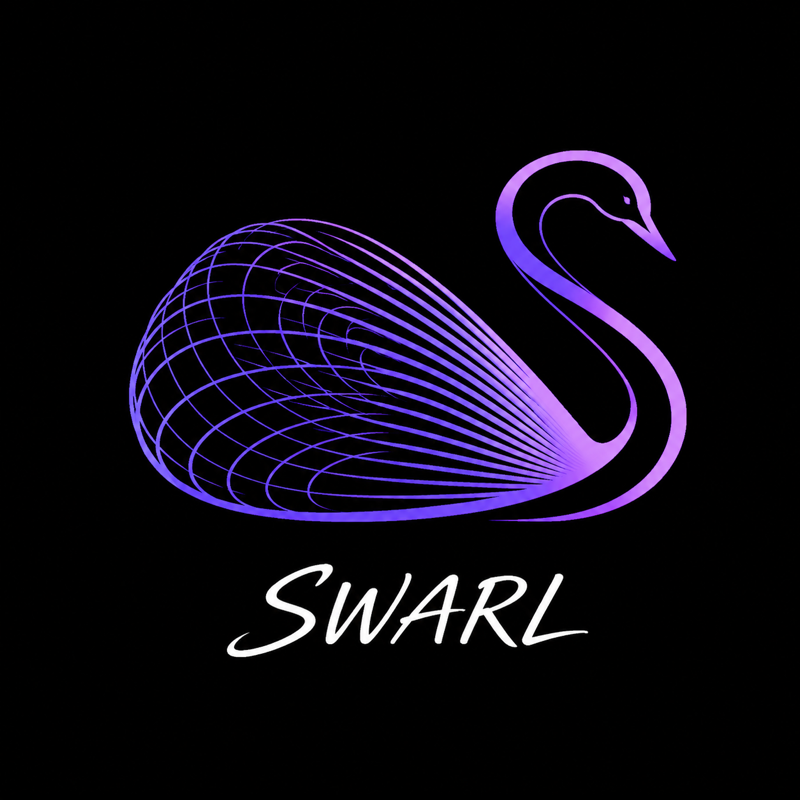

<p align="center">
  
</p>


<p align="center"><b>SWARL:- RL Post-Training and Alignment Library for LLMs</b></p>

A RL training library for LLM post-training
and RL alignment.

Built strictly for **text sequences**, not general-purpose RL for robotics
or games. 

## Algorithm status

| Algorithm | Status | Stage |
|---|---|---|
| DPO (Direct Preference Optimization) |  Stage 1 (~90%) | offline |
| REINFORCE | ⏳ planned | online |
| GRPO / DAPO | ⏳ planned | online |
| PPO (clipped surrogate + GAE) | ⏳ planned | online |
| GSPO / CISPO / SPIN / SPPO | ⏳ planned | later |
| On-Policy Distillation (OPD) | ⏳ planned | later |

See [ROADMAP.md](ROADMAP.md) for the full stage-by-stage build plan.

## Design philosophy

**Isolate the piece with the fewest moving parts, prove it fully correct,
then add exactly one new source of complexity at a time.**

```
DPO       → model + data + loss          (no generation)
REINFORCE → + generation
GRPO      → + group-relative advantage
PPO       → + critic/value network
FSDP2     → + distributed sharding       (only once algorithms are correct)
```

This is why the library starts with DPO: it needs only two things every
later algorithm needs anyway — a model that computes log-probabilities and
a dataset loader. No generation engine, no reward function, no critic.

## Install

```bash
git clone https://github.com/TASMAYU/SWARL.git
cd SWARL
uv sync
```

Requires Python ≥ 3.13.

## Usage

```python
from myrlx.trainers.offline import DPOTrainer

trainer = DPOTrainer(model_name="Qwen/Qwen2.5-0.5B-Instruct", beta=0.1)
records = [
    {"prompt": "...", "chosen": "...", "rejected": "..."},
]
trainer.train(records, epochs=1, batch_size=2)
```

**Full runnable demo:** [`examples/train_dpo_demo.py`](examples/train_dpo_demo.py)
trains on real preference data (`trl-lib/ultrafeedback_binarized`) and checks
that held-out reward accuracy rises above 0.5. See [examples/README.md](examples/README.md).

## Tests

```bash
uv run pytest -q     # CPU only, tiny random models, runs in about a second
```

## Project structure

```
swarl/
├── core/        # PolicyModel, ReferenceManager, (later: generation, FSDP2)
├── data/        # preference & prompt datasets, dataset loaders
├── losses/      # DPO, (later: REINFORCE, GRPO, DAPO, PPO, ...)
├── trainers/    # offline (DPO), (later: online, OPD)
├── rewards/     # (later: verifiers, reward models)
├── examples/    # runnable demos per stage
└── tests/
```

## License

MIT — see [LICENSE](LICENSE).
